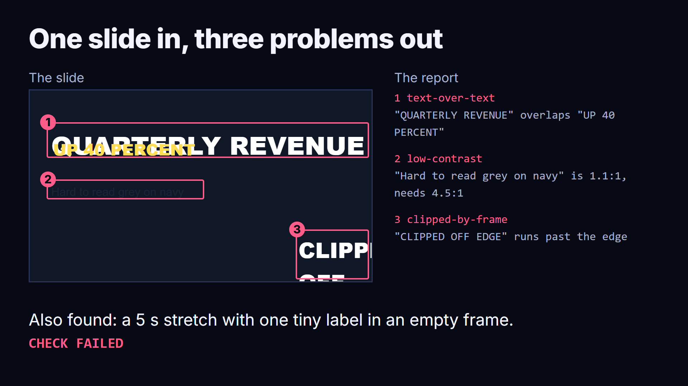

# remotion-qa-check

Catch layout and emptiness problems in a [Remotion](https://remotion.dev) composition before you render the final video.



One low-resolution render gives two checks:

| Check | What it flags |
|---|---|
| **Layout probe** (reads the DOM) | text covered by another element, text over text, text clipped by the frame, low contrast (below 4.5:1, or 3:1 at 40 px and up) |
| **Frame fill** (reads pixels) | stretches where the frame is nearly empty, and frames where everything sits in a small corner |
| **Script check** (optional) | on-screen words that are not in your script file |

An issue counts only when it persists for three samples in a row (15 frames at the default), so entrances and crossfades are ignored. The exit code is 1 when anything persistent is found, so it works in CI.

## Use

Run it from the root of your Remotion project:

```bash
git clone https://github.com/syedaneesurrehman/remotion-qa-check
cd remotion-qa-check && npm install && cd ..
node remotion-qa-check/bin/qa.mjs src/Intro Intro 450 --width 1920 --height 1080
```

Arguments: `<module> <ExportName> <durationInFrames>`.

| Option | Default | Meaning |
|---|---|---|
| `--width`, `--height`, `--fps` | 1920, 1080, 30 | composition size (use 1080x1920 for vertical) |
| `--every` | 5 | probe every Nth frame |
| `--range a-b` | all | check only these frames |
| `--script file.txt` | off | flag on-screen words that are not in the file |
| `--allow "a,b"` | none | extra allowed words for `--script` |
| `--max-empty-run` | 1.5 | longest allowed near-empty stretch, in seconds |

## Example

`example/BadSlide.tsx` is a deliberately flawed slide. Running it:

```text
probe sampled 48 frames; persistent text issues: 3 (script check off: no --script)
 - low-contrast: "Hard to read grey on n" has 1.1:1 at 64px (needs 4.5:1, or 3:1 at 40px+)  (frames 0-85)
 - clipped-by-frame: "CLIPPED OFF EDGE"  (frames 0-85)
 - text-over-text: "QUARTERLY REVENUE" is covered by / overlaps UP 40 PERCENT  (frames 0-85)
frame fill: 15 samples, empty 10, sparse 67%, longest empty run 5.0s at t=3.0s
FRAME-FILL FAIL: a near-empty stretch, or most frames use only a small part of the frame

CHECK FAILED
```

A clean composition prints `CHECK PASSED`.

## How it works

1. Writes a temporary entry file in `.remotion-qa/` that wraps your component in a probe and registers it as a composition.
2. Renders a quarter-scale JPEG sequence with `remotion render --sequence`.
3. The probe logs, from the DOM, where every piece of text sits and what covers it. The tool reads those console lines.
4. The fill check samples every 15th frame, finds strong edges (the "ink") and measures how much of the frame they use.

## Limits

- Only checks text in the DOM. Text drawn into a `<canvas>` or WebGL is invisible to the probe.
- Contrast is measured only against a solid background colour. Text over photos or gradients is skipped.
- The fill thresholds (ink under 0.35% = empty, ink area under 18% of the frame = sparse) suit title-and-graphic style videos. Footage-heavy videos may need `--max-empty-run` raised.
- The composition is rendered with its own props. Pass state through the exported component if it needs inputs.
- Tested on Windows 11 with Remotion 4 and Node 24.

## License

MIT
